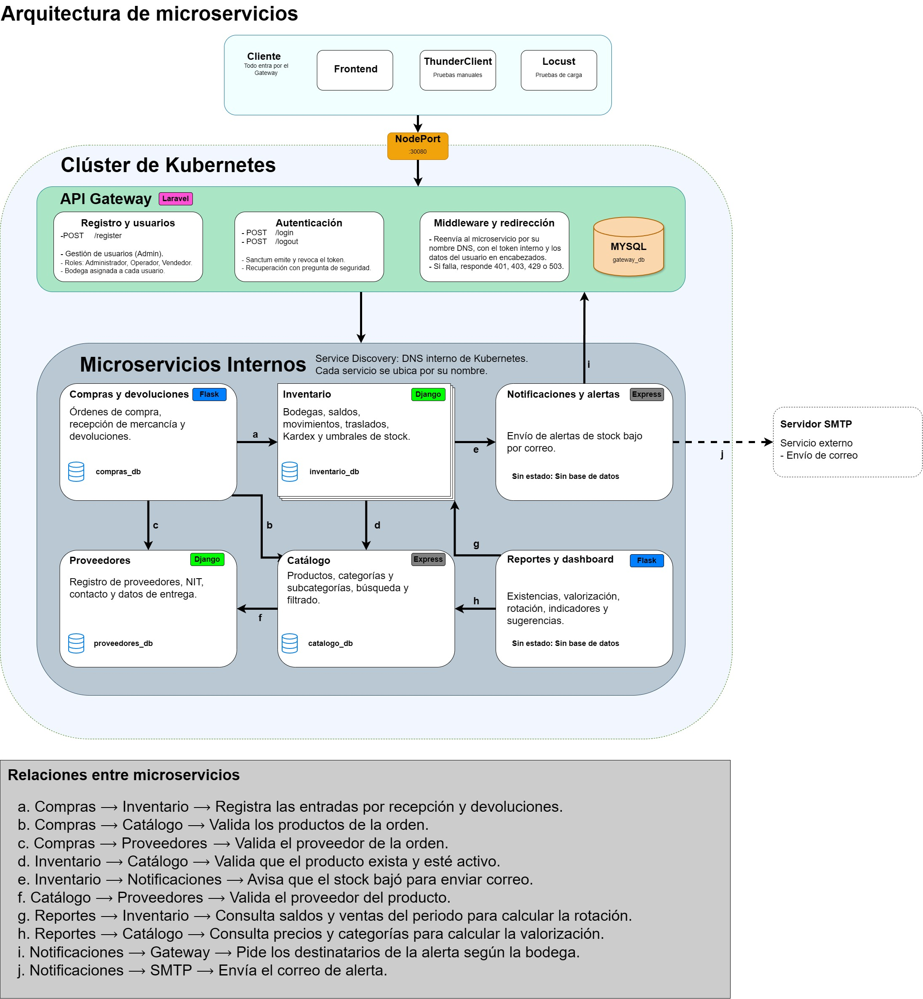

# Sistema de Gestión de Inventarios - Ferretería Cafetera

Proyecto de **Ingeniería de Software II** de la Universidad Nacional de Colombia, sede Manizales.

Sistema de gestión de inventarios basado en una arquitectura de microservicios para Ferretería Cafetera, una pyme distribuidora de materiales de construcción con sede principal en Manizales y bodegas en Pereira y Armenia. El sistema reemplaza el kardex manual de la empresa, descuenta el inventario en el momento de cada venta, permite consultar la disponibilidad en las tres sedes y genera alertas cuando un producto baja de su stock mínimo.

## Equipo

- Oswin Olsman Cuaran Cuaran
- Santiago Lopez

**Docente:** Albeiro Montes

## Arquitectura



Todas las peticiones entran por un API Gateway propio, que valida el token de Sanctum y el rol del usuario y redirige cada petición al microservicio que corresponde. Los microservicios se comunican entre sí por medio de API REST y se ubican por su nombre gracias al DNS interno de Kubernetes. Cada servicio administra únicamente su propia base de datos.

| Componente | Carpeta | Framework | Base de datos |
|---|---|---|---|
| API Gateway (usuarios y autenticación) | [`gateway/`](gateway/README.md) | Laravel + Sanctum | gateway_db |
| Inventario | [`inventario/`](inventario/README.md) | Django | inventario_db |
| Proveedores | [`proveedores/`](proveedores/README.md) | Django | proveedores_db |
| Catálogo | [`catalogo/`](catalogo/README.md) | Express | catalogo_db |
| Compras y devoluciones | [`compras/`](compras/README.md) | Flask | compras_db |
| Notificaciones y alertas | [`notificaciones/`](notificaciones/README.md) | Express | Sin base de datos |
| Reportes y dashboard | [`reportes/`](reportes/README.md) | Flask | Sin base de datos |

Cada carpeta tiene su propio README con las funcionalidades del servicio, su tecnología y los servicios con los que se comunica.

## Estructura del repositorio

```
├── gateway/          API Gateway en Laravel con Sanctum
├── inventario/       Microservicio de Inventario en Django
├── proveedores/      Microservicio de Proveedores en Django
├── catalogo/         Microservicio de Catálogo en Express
├── compras/          Microservicio de Compras y devoluciones en Flask
├── notificaciones/   Microservicio de Notificaciones y alertas en Express
├── reportes/         Microservicio de Reportes y dashboard en Flask
├── k8s/              Manifiestos de Kubernetes
├── pruebas/          Pruebas de rendimiento con Locust
├── docs/
│   ├── Entrega_1/    Investigación, requisitos y bitácora de IA
│   └── Entrega_2/    Arquitectura, modelos entidad relación, contratos de API, documento y bitácora
└── README.md
```

Las bases de datos no tienen carpeta propia: cada una corre en su propio contenedor de MySQL, que crea la base de datos automáticamente la primera vez que arranca.

## Cómo ver la documentación

- **Modelos entidad relación:** abrir cualquier archivo `.dbml` en [dbdiagram.io](https://dbdiagram.io).
- **Contratos de API:** abrir cualquier archivo `.yaml` en [Swagger Editor](https://editor.swagger.io).

## Flujo de trabajo

Cada integrante trabaja en su propia rama (`oswin` y `santiago`). Los cambios llegan a `main` por medio de un pull request que revisa y aprueba el otro integrante.

## Uso de inteligencia artificial

El proyecto usa herramientas de IA generativa como apoyo en todas sus fases. Cada entrega incluye una bitácora que registra cómo se usó la IA, qué se modificó de lo que generó y qué aprendió el equipo.
